# i2f-springboot-ai-starter

> AI 能力总装 Starter —— 把 `i2f-ai-std` 的 Agent 契约、`i2f-ai-rest-openai` 的模型实现、RAG/技能/工具三套子系统一次性装进
> Spring 容器：三选一注册对话模型 `AiModel`，把容器里所有 `@Tools` Bean 汇成应用内工具供应商（`app_context`）与 MCP
> 工具网关，扫描 `./tools/*.groovy` 做工具热插拔、扫描 `./skills/<name>/SKILL.md` 做技能热加载、装配 sqlite-vec 向量库 +
> 文档库 + 四种 CLI 文档读取器做 RAG，并以 `BeanDefinitionRegistryPostProcessor` 把 `@AiService`
> 接口实例化为「方法即提示词、参数即上下文、返回值即结构化输出」的声明式 AI 服务。

## 模块路径

- `i2f-springboot/i2f-springboot-ai-starter`

## 模块依赖

| GroupId                  | ArtifactId                          | Scope    | Optional | 说明                                                                                                         |
|--------------------------|-------------------------------------|----------|----------|------------------------------------------------------------------------------------------------------------|
| org.projectlombok        | lombok                              | compile  | false    | 编译期代码生成（`@Data`/`@Slf4j`/`@NoArgsConstructor`）                                                             |
| org.springframework.boot | spring-boot-starter                 | provided | true     | 自动装配基础与 `@ConditionalOn*`                                                                                  |
| org.springframework.boot | spring-boot-configuration-processor | provided | true     | `@ConfigurationProperties` 元数据生成                                                                           |
| org.springframework.boot | spring-boot-starter-web             | provided | true     | `RestTemplateBuilder`/`RestTemplate`（模型与嵌入的 HTTP 通道）                                                       |
| i2f.turbo                | i2f-ai-std                          | compile  | false    | **全部扩展契约来源**：`AiModel`/`AiAgent`/`ToolManager`/`McpToolProvider`/`SkillsHelper`/`RagWorker`/`@AiService` 等 |
| i2f.turbo                | i2f-ai-rest-openai                  | compile  | false    | `HttpOpenAiAiModel`（默认对话模型）、`HttpOpenAiRagEmbeddingModel`（默认嵌入模型）                                          |
| i2f.turbo                | i2f-spring-core                     | compile  | false    | `SpringContext`（把 Spring 容器适配为 `i2f` 的 `IContext`/`INamingContext`）                                        |
| i2f.turbo                | i2f-spring-web                      | compile  | false    | `SpringWebRestClient`（把 `IRestClient` 落到 Spring `RestTemplate`）                                            |
| i2f.turbo                | i2f-extension-ai-dashscope          | compile  | false    | `DashScopeModel`，`model.dashscope.enable=true` 时启用                                                         |
| i2f.turbo                | i2f-extension-ai-openai             | compile  | false    | `OpenAiModel`（官方 SDK），`model.openai.enable=true` 时启用                                                       |
| i2f.turbo                | i2f-extension-ai-langchain4j8       | compile  | false    | **声明未用**：源码零引用                                                                                             |
| i2f.turbo                | i2f-extension-jackson               | compile  | false    | `JacksonJsonSerializer`，把容器 `ObjectMapper` 适配为 `IJsonSerializer`                                           |
| i2f.turbo                | i2f-extension-ai-rag-sqlite         | compile  | false    | `SqliteRagEmbeddingStore`/`SqliteRagDocumentsStore`/`SqliteBucketRagMemoryStore` + sqlite-vec 原生库          |
| i2f.turbo                | i2f-extension-document              | compile  | false    | `PdfConvertUtil`（PDF→图片，供 pdf-easyocr 读器）                                                                  |
| i2f.turbo                | i2f-extension-groovy                | compile  | false    | `GroovyScript.parseAsClass`（动态工具 / 技能脚本）                                                                   |
| com.alibaba              | dashscope-sdk-java                  | provided | true     | `Generation`，版本硬编码 `2.22.12`，排除 slf4j-api/simple                                                           |
| com.openai               | openai-java                         | provided | true     | `OpenAIClient`，版本硬编码 `4.28.0`，排除 kotlin-stdlib-jdk8                                                        |
| org.jetbrains.kotlin     | kotlin-stdlib                       | provided | true     | 版本硬编码 `1.9.24`（openai-java 运行所需）                                                                           |
| org.apache.pdfbox        | pdfbox                              | provided | true     | 版本硬编码 `2.0.29`，`PdfEasyOcrCmdRagFileReader` 类条件依赖                                                          |
| org.apache.groovy        | groovy                              | provided | true     | 版本硬编码 `4.0.18`                                                                                             |

> 注意：
> - 本模块**自身产出的 Bean 依赖宿主具备 Spring Web**（`RestTemplateBuilder`），但 web starter 是 `provided + optional`，非
    Web 应用需自行引入。
> - `dashscope-sdk-java`/`openai-java`/`pdfbox`/`groovy` 均 `provided + optional`，只有走对应分支时宿主才必须补齐。
> - 版本号逐条内联（不含 `dependencyManagement`），与根 POM 的统一版本策略不一致。

## 模块设计

### 架构分层

按「基础设施 → 模型 → 工具 → 技能 → RAG → Agent → 声明式服务」七层组织，全部由 `@ConditionalOnExpression` 独立开关控制：

- **基础设施层**（`AiCommonAutoConfiguration`）：把容器 `ObjectMapper` 适配为全局 `IJsonSerializer`
  ，并注册 `JsonSchemaAnnotationResolver.INSTANCE`（两者均 `@ConditionalOnMissingBean`，可让位）
- **模型层**（`AiModelAutoConfiguration`）：三个互斥候选 Bean——`rest-openai`（`HttpOpenAiAiModel`
  ，默认开）、`dashscope`（`DashScopeModel`，默认关）、`openai`（`OpenAiModel`
  ，默认关），均带 `@ConditionalOnMissingBean(AiModel.class)`，**按声明顺序先到先得**
- **工具层**（`AiToolsAutoConfiguration` + `GroovyDynamicToolProvider` + `McpProviderTools`）：把容器内 `@Tools` Bean
  收成 `ContextAppMcpToolProvider`（名为 `app_context`），把容器内 `McpToolProvider` Bean
  收成 `ContextMcpToolGatewayManager` 网关，另注册 4
  个「发现/加载工具」用于大模型按需自助装载工具；`ContextMcpToolGatewayManager` 与 `ContextAppToolManager`
  都是 `ToolManager`，共用 `@ConditionalOnMissingBean(ToolManager.class)` 而**二选一**（默认网关，可用开关换向）
- **技能层**（`AiSkillsAutoConfiguration` + `GroovySkillScriptRunner`）：每 30s 扫描 `./skills`
  ，产出 `SkillsTools`（`skill_search`/`get_skill_document`/`get_skill_resource`/`run_skill_script`）与 `.groovy` 脚本执行器
- **RAG 层**（`AiRagsAutoConfiguration` + `MemoryTools`）：OpenAI 兼容嵌入 + sqlite-vec 向量库 +
  文档登记库 + `RagWorker` + `RagTools` + 4 种 CLI 读器 + 桶式长期记忆库与记忆工具
- **Agent 层**（`AiAgentAutoConfiguration`）：装配唯一 `AiAgent` 门面（模型 + 序列化器 + 可选 RAG + Schema 解析器）
- **声明式服务层
  **（`AiServiceProxyInterfaceAutoConfiguration` + `AiServiceProxyInterfaceFactoryBean`）：`BeanDefinitionRegistryPostProcessor`
  扫 `@AiService` 接口，为每个接口注册 `FactoryBean`，`getObject()` 时经 `AiServices.create(clazz, handler)` 产出 JDK 动态代理

### 自动装配结构

```mermaid
flowchart TD
    subgraph INFRA["基础设施"]
        COMMON["AiCommonAutoConfiguration<br/>i2f.springboot.ai.enable"]
        JS["IJsonSerializer<br/>JacksonJsonSerializer(ObjectMapper)"]
        JSR["JsonSchemaAnnotationResolver<br/>INSTANCE"]
        COMMON --> JS
        COMMON --> JSR
    end

    subgraph MODEL["模型层"]
        MA["AiModelAutoConfiguration<br/>i2f.springboot.ai.model.enable"]
        M1["HttpOpenAiAiModel<br/>rest-openai 默认开"]
        M2["DashScopeModel<br/>dashscope 默认关"]
        M3["OpenAiModel<br/>openai 默认关"]
        MA --> M1
        MA -.同 @ConditionalOnMissingBean.-> M2
        MA -.同 @ConditionalOnMissingBean.-> M3
    end

    subgraph TOOLS["工具层"]
        TA["AiToolsAutoConfiguration"]
        AP["ContextAppMcpToolProvider<br/>name=app_context"]
        GM["ContextMcpToolGatewayManager<br/>ToolManager"]
        ATM["ContextAppToolManager<br/>开关切换时启用"]
        MPT["McpProviderTools<br/>4 个工具发现/加载工具"]
        GD["GroovyDynamicToolProvider<br/>./tools/*.groovy 15s 热扫"]
        TA --> AP
        TA --> GM
        TA -.与网关二选一.-> ATM
        TA --> MPT
        GD --> CTRL["按 ToolRawDefinitionsProvider<br/>并入容器工具集"]
    end

    subgraph SKILL["技能层"]
        SA["AiSkillsAutoConfiguration"]
        ST["SkillsTools"]
        SR["GroovySkillScriptRunner"]
        SA --> ST
        SA -.按后缀匹配.-> SR
    end

    subgraph RAG["RAG 层"]
        RA["AiRagsAutoConfiguration"]
        EM["RagEmbeddingModel<br/>HttpOpenAiRagEmbeddingModel"]
        ES["RagEmbeddingStore<br/>SqliteRagEmbeddingStore"]
        DS["RagDocumentsStore<br/>SqliteRagDocumentsStore"]
        RW["RagWorker"]
        RT["RagTools"]
        RD["RagFileReader ×4<br/>markitdown/easyocr/pdf-easyocr/pandoc"]
        BS["BucketRagEmbeddingStore<br/>SqliteBucketRagMemoryStore"]
        MT["MemoryTools<br/>memory_search/save/delete"]
        RA --> EM
        RA --> ES
        RA --> DS
        RA --> RW
        RA --> RT
        RA --> RD
        RA --> BS
        RA --> MT
    end

    subgraph AGENT["Agent 层"]
        AA["AiAgentAutoConfiguration"]
        AG["AiAgent"]
        AA --> AG
    end

    subgraph SVC["声明式服务层"]
        PA["AiServiceProxyInterfaceAutoConfiguration<br/>BeanDefinitionRegistryPostProcessor"]
        HD["AiServiceDynamicProxyHandler"]
        FB["FactoryBean → @AiService 接口代理"]
        PA --> HD
        PA --> FB
    end

    JS --> AG
    JSR --> AG
    M1 --> AG
    RW --> AG
    AG --> HD
    MPT --> OPS["下游 ops-starter 读取<br/>getLoadedTools()/SYSTEM_PROMPT"]
```



### 条件装配一览

| 类 / Bean 方法                                | 条件                                                                                             | 默认    | 说明                                                                             |
|--------------------------------------------|------------------------------------------------------------------------------------------------|-------|--------------------------------------------------------------------------------|
| `AiCommonAutoConfiguration`                | `${i2f.springboot.ai.enable:true}`                                                             | 开     | **仅门控自身 Bean**，不是全局开关                                                          |
| `#jsonSerializer`                          | `...ai.json-serializer.enable:true` + `@ConditionalOnMissingBean(IJsonSerializer)`             | 开     | 宿主自定义即让位                                                                       |
| `#jsonSchemaAnnotationResolver`            | `...ai.json-schema-annotation-resolver.enable:true` + `@ConditionalOnMissingBean`              | 开     | 注册 `JsonSchemaAnnotationResolver.INSTANCE`，宿主可覆盖                               |
| `AiModelAutoConfiguration`                 | `${i2f.springboot.ai.model.enable:true}`                                                       | 开     | 三候选互斥                                                                          |
| `#aiModel(rest-openai)`                    | `...model.rest-openai.enable:true` + `@ConditionalOnMissingBean(AiModel.class)`                | **开** | 声明最前，优先生效                                                                      |
| `#aiModel(dashscope)`                      | `...model.dashscope.enable:false` + `@ConditionalOnClass(Generation, DashScopeModel)`          | **关** | 需显式开启，且需先关 rest-openai                                                         |
| `#aiModel(openai)`                         | `...model.openai.enable:false` + `@ConditionalOnClass(OpenAIClient, OpenAiModel)`              | **关** | 同上                                                                             |
| `AiToolsAutoConfiguration`                 | `${i2f.springboot.ai.tools.enable:true}`，`@AutoConfigureOrder(5000)`                           | 开     | 工具层总开关                                                                         |
| `#appMcpToolProvider`                      | `...tools.mcp.app.enable:true` + `@ConditionalOnMissingBean(ContextAppMcpToolProvider)`        | 开     | 应用内工具供应商                                                                       |
| `#mcpToolGatewayManager`                   | `...tools.mcp.manager.enable:true` + `@ConditionalOnMissingBean(ToolManager)`                  | 开     | MCP 网关                                                                         |
| `#appToolManager`                          | `...tools.app.manager.enable:true` + `@ConditionalOnMissingBean(ToolManager)`                  | 开     | 与上一条**互斥二选一**，默认被网关占据（有意设计）                                                    |
| `#mcpProviderTools`                        | `...tools.mcp-gateway.enable:true`                                                             | 开     | 强依赖 `AbstractMcpToolGatewayManager` Bean（默认由网关提供）                              |
| `GroovyDynamicToolProvider`                | `...tools.groovy-dynamic-tools.enable:true` + `@ConditionalOnClass(GroovyScript, GroovyShell)` | 开     | `@Component` + 导入列表双重身份                                                        |
| `AiSkillsAutoConfiguration`                | `${i2f.springboot.ai.skills.enable:true}`                                                      | 开     | 技能层总开关                                                                         |
| `#skillsTools`                             | `...skills.tool.enable:true`                                                                   | 开     | 4 个技能工具                                                                        |
| `GroovySkillScriptRunner`                  | `...skills.runner.groovy.enable:true` + `@ConditionalOnClass`                                  | 开     | `.groovy` 脚本执行器                                                                |
| `AiRagsAutoConfiguration`                  | `${i2f.springboot.ai.rags.enable:true}`                                                        | 开     | RAG 层总开关                                                                       |
| `#ragEmbeddingModel`                       | `...rags.embedding.enable:true` + `@ConditionalOnMissingBean(RagEmbeddingModel)`               | 开     | `HttpOpenAiRagEmbeddingModel`                                                  |
| `#ragEmbeddingStore`                       | `...rags.store.enable:true` + `@ConditionalOnMissingBean(RagEmbeddingStore)`                   | 开     | `SqliteRagEmbeddingStore`                                                      |
| `#ragDocumentsStore`                       | `...rags.docs-store.enable:true` + `@ConditionalOnMissingBean(RagDocumentsStore)`              | 开     | `SqliteRagDocumentsStore`                                                      |
| `#ragWorker`                               | `...rags.worker.enable:true` + `@ConditionalOnMissingBean(RagWorker)`                          | 开     | 强依赖上两个 Bean（无 `required=false`）                                                |
| `#ragTools`                                | `...rags.tool.enable:true` + `@ConditionalOnMissingBean(RagTools)`                             | 开     | `RagTools(ragWorker)`                                                          |
| `#markitdownCmdRagFileReader`              | `...rags.reader.markitdown.enable:true`                                                        | 开     | 需外部 `markitdown` CLI                                                           |
| `#easyOcrCmdRagFileReader`                 | `...rags.reader.easycor.enable:true`                                                           | 开     | 属性名少一个 `o`，需外部 `easyocr` CLI                                                   |
| `#pdfEasyOcrCmdRagFileReader`              | `...rags.reader.pdf-easycor.enable:true` + `@ConditionalOnClass(PDDocument)`                   | 开     | PDF→图→OCR                                                                      |
| `#pandocCmdRagFileReader`                  | `...rags.reader.pandoc.enable:true`                                                            | 开     | 需外部 `pandoc` CLI                                                               |
| `#bucketRagEmbeddingStore`                 | `...rags.memory.bucket.enable:true` + `@ConditionalOnMissingBean(BucketRagEmbeddingStore)`     | 开     | 桶式记忆库                                                                          |
| `#memoryTools`                             | `...rags.memory.enable:true` + `@ConditionalOnMissingBean(MemoryTools)`                        | 开     | `MemoryTools`，bucket 由 `ToolCallContextHolder` 传递                              |
| `AiAgentAutoConfiguration`                 | `${i2f.springboot.ai.agent.enable:true}`                                                       | 开     | Agent 层总开关                                                                     |
| `#aiAgent`                                 | `...agent.enable:true` + `@ConditionalOnMissingBean(AiAgent)`                                  | 开     | 注入 `AiModel`/`IJsonSerializer` + 可选 `RagWorker`/`JsonSchemaAnnotationResolver` |
| `AiServiceProxyInterfaceAutoConfiguration` | `${i2f.springboot.ai.proxy.enable:true}`，`@AutoConfigureAfter(AiCommonAutoConfiguration)`      | 开     | 声明式服务注册器                                                                       |
| `#aiServiceDynamicProxyHandler`            | `...proxy.handler.enable:true` + `@ConditionalOnMissingBean`                                   | 开     | 可整体替换代理行为                                                                      |

> `IJsonSerializer` 与 `JsonSchemaAnnotationResolver` 在 `AiCommonAutoConfiguration`（:
> 31-43）与 `AiAgentAutoConfiguration`（:
> 33-45）各声明一份同条件副本，实际生效的是先注册的那份；若把 `json-schema-annotation-resolver.enable`
> 一并置 `false`，`aiAgent` 会以 `null` 装配（见瑕疵 2）。

> **`ToolManager` 二选一是刻意设计**：`mcpToolGatewayManager` 与 `appToolManager`
> 共用 `@ConditionalOnMissingBean(ToolManager.class)`，容器内只保留一个实例，默认落在 MCP 网关。若应用只要应用内 `@Tools`
> Bean、不要 MCP 网关，把 `tools.mcp.manager.enable` 置 `false`、`tools.app.manager.enable` 保持 `true` 即完成换向；*
*同时必须关 `tools.mcp-gateway.enable`**，因为 `McpProviderTools` 强依赖 `AbstractMcpToolGatewayManager`。

### 包结构

```
i2f.springboot.ai
├── common/AiCommonAutoConfiguration          # IJsonSerializer + JsonSchemaAnnotationResolver
├── model/AiModelAutoConfiguration            # 三选一 AiModel
├── model/properties/AiModel*Properties       # rest-openai / dashscope / openai 三组属性
├── tools/AiToolsAutoConfiguration            # app 工具供应商 / MCP 网关 / McpProviderTools
├── tools/McpProviderTools                    # tools_provider_list / list_tools_from_providers / search_tools / load_tools_by_names
├── tools/GroovyDynamicToolProvider           # ./tools/**/*.groovy 热加载为容器工具
├── skills/AiSkillsAutoConfiguration          # ./skills 扫描 + SkillsTools
├── skills/GroovySkillScriptRunner            # .groovy 技能脚本执行器
├── rags/AiRagsAutoConfiguration              # 嵌入/向量库/文档库/Worker/工具/读器/记忆库
├── rags/AiRagsEmbeddingModelProperties       # i2f.springboot.ai.rags.embedding.*
├── rags/MemoryTools                          # memory_search / memory_save / memory_delete
├── agent/AiAgentAutoConfiguration            # AiAgent 门面（另含 serializer / resolver 同条件副本）
├── services/AiServiceProxyInterfaceAutoConfiguration   # @AiService 扫描注册
├── services/AiServiceProxyInterfaceFactoryBean         # 接口 → JDK 动态代理
└── services/properties/AiProxyServiceProperties        # i2f.springboot.ai.proxy.*
```

资源：`META-INF/spring.factories` 与 `META-INF/spring/org.springframework.boot.autoconfigure.AutoConfiguration.imports`（同
9 项双注册）、`META-INF/additional-spring-configuration-metadata.json`（11 groups / 49 properties，已按源码全量同步，无死
hints）、`sample/application-ai.yml`（model/rags/skills/tools/proxy 全套样例）。

## 模块目的

1. **AI 栈一键接入**：引依赖 + 三行配置即可拿到 `AiModel`、`AiAgent`、`IJsonSerializer`，无需手写装配。
2. **模型可换、可覆盖**：REST OpenAI（无 SDK 依赖、任何 OpenAI 兼容网关可用）/ DashScope SDK / OpenAI 官方 SDK
   三选一，且 `@ConditionalOnMissingBean` 允许宿主完全接管。
3. **容器即工具源**：应用里任何带 `@Tools`/`@Tool` 的 Bean 自动成为可被大模型调用的工具（`app_context` 供应商），无需注册表。
4. **工具可热插拔**：`./tools` 下丢 `.groovy` 即可新增工具，改文件 15s 生效；工具数量过多时由 `McpProviderTools`
   引导大模型「先发现、再搜索、后加载」。
5. **技能可热加载**：`./skills/<name>/SKILL.md` 目录式技能，30s 刷新；技能文档 + 资源 + 脚本三件套由标准化工具读取与执行。
6. **RAG 开箱可用**：嵌入模型 + sqlite-vec 向量库 + 文档登记库 + 读器链 + `RagWorker`/`RagTools` 全自动装配，`./rags`
   目录投文件即被切分入库并归档。
7. **声明式 AI 服务**：`@AiService` 接口即服务，注解声明系统提示词、工具集、技能集、Agent 选择，返回类型决定结构化输出与 JSON
   反序列化。
8. **长期记忆**：桶式向量库 + `MemoryTools`（`memory_search`/`memory_save`/`memory_delete`）提供 user 级记忆读写，bucket
   由 `ToolCallContextHolder` 在线程内传递。

## 模块功能

| 功能组      | Bean / 类型                                     | 说明                                                                                                       |
|----------|-----------------------------------------------|----------------------------------------------------------------------------------------------------------|
| 序列化      | `IJsonSerializer`                             | `JacksonJsonSerializer(容器 ObjectMapper)`，供 Agent 序列化工具返回值与结构化输出                                          |
| 对话模型     | `AiModel`                                     | `HttpOpenAiAiModel`（默认）/`DashScopeModel`/`OpenAiModel` 三选一                                               |
| 应用工具供应商  | `ContextAppMcpToolProvider`                   | 名称 `app_context`，工具 = 容器内全部 `@Tools` Bean 的 `@Tool` 方法                                                   |
| MCP 工具网关 | `ContextMcpToolGatewayManager`                | 聚合容器内所有 `McpToolProvider`，工具名以 `provider.` 前缀命名空间隔离；也是容器内默认（且唯一）`ToolManager`                            |
| 工具发现/加载  | `McpProviderTools`（`@McpServerExpose(false)`） | `tools_provider_list`、`list_tools_from_providers`、`search_tools`、`load_tools_by_names` + `SYSTEM_PROMPT` |
| 动态工具     | `GroovyDynamicToolProvider`                   | 递归扫 `./tools` 下 `.groovy`，编译→`autowireBean`→`@Tool` 解析→15s 增量刷新                                          |
| 技能工具     | `SkillsTools`                                 | `skill_search`、`get_skill_document`、`get_skill_resource`、`run_skill_script`                              |
| 技能脚本     | `SkillScriptRunner`（`.groovy`）                | `GroovyShell` 执行，绑定 `out` 变量，返回「最后返回值 + stdout」，3 分钟上限                                                   |
| 嵌入模型     | `RagEmbeddingModel`                           | `HttpOpenAiRagEmbeddingModel`（`{baseUrl}/embeddings`）                                                    |
| 向量库      | `RagEmbeddingStore`                           | `SqliteRagEmbeddingStore`（sqlite-vec `vec0` 虚拟表，cosine）                                                  |
| 文档登记库    | `RagDocumentsStore`                           | `SqliteRagDocumentsStore`，避免重复入库                                                                         |
| 桶式记忆库    | `BucketRagEmbeddingStore`                     | `SqliteBucketRagMemoryStore`，按 bucket 隔离                                                                 |
| RAG 工人   | `RagWorker`                                   | 嵌入 + 存取 + 检索 + 重排门面；启动后 3s 触发 `loadDocs`                                                                 |
| RAG 工具   | `RagTools`                                    | 面向大模型的知识库检索/入库工具（`i2f-ai-std` 定义）                                                                        |
| 文档读器     | `RagFileReader` ×4                            | markitdown / easyocr / pdf-easyocr（PDFBox 转图）/ pandoc，均由 `ContextRagFileReader` 按 `support()` 派发         |
| Agent    | `AiAgent`                                     | 模型 + 序列化器 + RAG + Schema 解析器；内置 Re-Act 循环、工具并发、历史压缩、结构化输出                                                |
| 声明式服务    | `@AiService` 接口代理                             | `AiServiceDynamicProxyHandler` + `FactoryBean`                                                           |
| 记忆工具     | `MemoryTools`                                 | `memory_search`/`memory_save`/`memory_delete`，bucket 由 `ToolCallContextHolder` 传递                        |

## 模块主要使用方法

### 1. 引入依赖

```xml
<dependency>
    <groupId>i2f.turbo</groupId>
    <artifactId>i2f-springboot-ai-starter</artifactId>
    <!-- 版本继承父 POM 统一管理（1.0-jdk8） -->
</dependency>
        <!-- 非 Web 应用需补 web（本模块 provided），走 dashscope/openai 分支需补对应 SDK -->
```

### 2. 最小配置

```yaml
i2f:
  springboot:
    ai:
      enable: true                       # 仅门控 IJsonSerializer/JsonSchemaAnnotationResolver，见「模块瑕疵或错误」
      model:
        rest-openai:
          enable: true                   # 默认开
          base-url: https://dashscope.aliyuncs.com/compatible-mode/v1
          api-key: ${AI_API_KEY}
          model: qwen-plus
```

> `base-url` 会被拼成 `{base-url}/chat/completions`，请填到 `/v1` 这一级（不要带 `/chat/completions`）。

### 3. 切换对话模型

```yaml
i2f:
  springboot:
    ai:
      model:
        rest-openai:
          enable: false                  # 必须关，否则先声明的它胜出
        dashscope:
          enable: true
          api-key: ${DASHSCOPE_API_KEY}
          model: qwen-plus               # 缺省 qwen-plus
        # openai:
        #   enable: true
        #   base-url: https://api.openai.com/v1
        #   api-key: ${OPENAI_API_KEY}
        #   model: gpt-4o-mini
```

### 4. 声明式 AI 服务（`@AiService`）

```yaml
i2f:
  springboot:
    ai:
      proxy:
        service-packages: # 可选；不配则扫 **.ai.** 与 **.service.**
          - demo.ai
          - com.example.**.service
```

`service-packages` 留空（默认）时，扫描器会回落到 `**.ai.**` 与 `**.service.**`
两个包模式（`AiServiceProxyInterfaceAutoConfiguration.java:66-71`）；单个条目内的 `.` 会被转成 `/`，可混用 `**` 通配。

```java

@AiService(
        tools = @AiTools(classes = {WeatherTools.class}),
        skills = @AiSkills(tags = {"weather"})
)
public interface WeatherAiService {

    @AiSystem({"你是一名严谨的气象播报员", "只依据工具返回的数据作答"})
    String ask(@AiParam(value = "city", description = "城市中文名") String city);

    @AiUser("用三句话总结上述对话")
    @AiSystem(format = true)
    SummaryDTO summarize(@AiParam("history") List<String> history);   // 返回 POJO → 结构化输出
}
```

调用侧零成本：

```java

@Autowired
private WeatherAiService weatherAiService;   // 由 FactoryBean 注入的 JDK 动态代理
```

返回类型语义（`AiServiceDynamicProxyHandler.invoke`）：

| 方法返回类型                  | 行为                                   |
|-------------------------|--------------------------------------|
| `void` / `Object`       | 返回 `AiAgentResponse`（含完整消息链与工具调用）    |
| `AiAgentResponse`       | 原样返回                                 |
| `AiMessage`             | 返回最后一轮助手消息                           |
| `CharSequence`/`String` | 返回最后一轮文本                             |
| 其它 POJO/集合              | 注入 JSON Schema 约束提示词 → 把最后文本反序列化为该类型 |

补充能力：

- `default` 方法不代理（可用于在接口里写工具方法）。
- 参数可为 `AiAgent` / `AiAgentContext` / `AiRequest`，用于逐次指定 Agent、上下文与请求对象，且不会作为提示词参数输出。
- 未消费的普通参数会被序列化后拼进 user 提示词（`# arg list` 段），可配 `@AiParam(description)` 补充语义。
- `@AiTools(value = {"beanName"})` 按 Bean 名装载工具；`@AiTools` 放参数上可接收工具对象/类名/`Iterable`/数组。
- 方法级 `@AiAgents` 优先级高于 `@AiService(agent = ...)`，都未命中时回落到容器中的 `AiAgent`。

### 5. 直接使用 `AiAgent`

```java

@Autowired
private AiAgent agent;

AiAgentResponse resp = agent.generate("系统提示词", "用户问题");
String text = resp.last().text();
```

`AiAgentContext` 才是真正的调参入口（工具/技能标签过滤、RAG 开关、历史压缩、工具调用次数上限、并发执行池、工具拦截器、结构化输出类型）：

```java
AiAgentContext ctx = new AiAgentContext()
        .enableRag(true).ragTopCount(3)
        .enableSkills(false)
        .maxAllToolCallCount(20)
        .enableParallelToolCall(true);
agent.

generate(new AiRequest().

system("...").

user("..."),ctx);
```

### 6. 业务工具：`@Tools` + `@Tool`

只要声明成 Bean，就自动进入 `app_context` 供应商，`@AiService` 里用 `@AiTools(classes=...)` 引用：

```java

@Tools(tags = {AiTags.READONLY_VALUE, AiTags.WEB_VALUE})
@Component
public class WeatherTools {

    @Tool(value = "weather_query", description = "查询指定城市当前天气", tags = AiTags.AUTO_VALUE)
    public Map<String, Object> query(
            @ToolParam(value = "city", description = "城市中文名，例如 杭州") String city) {
        return Map.of("city", city, "weather", "晴", "temperature", 26);
    }
}
```

`@McpServerExpose(false)` 可让该工具在本容器内可用、但不被 `i2f-springboot-ai-mcp-server` 对外暴露。

### 7. 远程/外部工具源

任何容器内 `McpToolProvider` Bean 都会被 `ContextMcpToolGatewayManager` 聚合，工具名加上 `<provider名>.`
前缀（`i2f-springboot-ai-mcp-client` 就是这样把远程 MCP Server 变成工具的）：

```java
@Autowired
private McpProviderTools mcpProviderTools;      // 直接当普通 Bean 调用

Map<String, Object> providers = mcpProviderTools.tools_provider_list();
```

> 网关聚合到什么，取决于宿主是否引入了 `i2f-springboot-ai-mcp-client` 或其他 `McpToolProvider`
> 实现；一个都没有时网关工具集为空，但 `app_context` 供应商不受影响。

#### 7.1 工具管理器二选一（有意设计）

容器内只保留一个 `ToolManager`：默认是 MCP 网关管理器 `ContextMcpToolGatewayManager`（同时实现 `ToolManager`
与 `AbstractMcpToolGatewayManager`），`ContextAppToolManager` 因同条件被抑制。若只想用应用内 `@Tools` Bean、不要 MCP
网关，用开关换向：

```yaml
i2f:
  springboot:
    ai:
      tools:
        mcp:
          manager:
            enable: false          # 关掉 MCP 网关管理器
        app:
          manager:
            enable: true           # 启用应用内工具管理器
        mcp-gateway:
          enable: false            # McpProviderTools 强依赖网关 Manager，必须同步关
```

换向后 `ContextAppToolManager` 从容器收集 `@Tools` Bean 的能力接管工具调度，代价是失去 `provider.` 前缀命名空间与远程 MCP
聚合能力（两者本就不可共存，因为网关本身就是 `ToolManager`）。

### 8. Groovy 热插拔工具

把脚本放进运行目录的 `./tools`（可嵌套子目录），15s 内生效：

```groovy
// ./tools/demo/hello.groovy
import i2f.ai.std.tool.annotations.Tool
import i2f.ai.std.tool.annotations.ToolParam

class HelloTool {
    @Tool(value = "demo_hello", description = "打招呼")
    String hello(@ToolParam(value = "name", description = "姓名") String name) {
        return "hello, " + name
    }
}
```

脚本实例会被 `AutowireCapableBeanFactory` 注入 Spring 依赖，因此脚本里可 `@Autowired` 业务 Bean。

### 9. 技能目录

```
./skills/weather/SKILL.md          # 元信息 + 文档正文
./skills/weather/script/report.groovy
```

`SKILL.md` 前置元信息用 `---` 分隔、`key: value` 形式：

```markdown
name: weather
description: 天气播报技能，能生成日报与预警摘要
tags: weather, report
version: 1.0
author: demo
---

# 正文：告诉模型如何使用资源与脚本
```

### 10. RAG 与长期记忆

```yaml
i2f:
  springboot:
    ai:
      rags:
        embedding:
          base-url: https://dashscope.aliyuncs.com/compatible-mode/v1
          api-key: ${AI_API_KEY}
          model: text-embedding-v4
          dimension: 1024              # 【必填】不同步会建出 float[0] 的表
          docs-path: ./rags            # 待入库原始文件目录
          max-segment-size-in-chars: 512
          max-overlap-rate: 0.15
        reader:
          pandoc:
            enable: false              # 未安装相应 CLI 时建议显式关闭
```

- 启动 3s 后自动对 `docs-path` 全量入库，随后把文件整体搬到同级 `rags_history/history-yyyyMMddHHmmss/`（源目录清空）。
- 向量库落盘在 `runtime/persist/sqlite-vec/sqlite-vec.db`，sqlite-vec 原生库首次运行从
  classpath `assets/sqlite-vec/{os}/{arch}/vec0.*` 释放到同目录。
- `AiAgentContext.enableRag(true)` 走被动注入（问答前把 top-N 片段拼进 system 消息），`enableRagAct(true)`
  额外注入 `RagTools` 让模型主动检索。
- 长期记忆（桶式，user 级）：`MemoryTools` 已由 Starter 自动装配，直接注入即可：

```java

@Autowired
private MemoryTools memoryTools;

MemoryTools.

setMemoryBucket("user-1024");   // 放在请求线程内，隔离记忆域
```

### 11. 配置项总表

| 前缀 / 键                                                                                                                                                       | 默认                                                    | 说明                                                                     |
|--------------------------------------------------------------------------------------------------------------------------------------------------------------|-------------------------------------------------------|------------------------------------------------------------------------|
| `i2f.springboot.ai.enable`                                                                                                                                   | `true`                                                | 仅门控 `IJsonSerializer`                                                  |
| `...ai.json-serializer.enable`                                                                                                                               | `true`                                                | 全局 JSON 序列化器                                                           |
| `...ai.json-schema-annotation-resolver.enable`                                                                                                               | `true`                                                | 注册 `JsonSchemaAnnotationResolver`；置 `false` 则 `AiAgent` 拿到 `null`（见瑕疵） |
| `...ai.model.enable`                                                                                                                                         | `true`                                                | 模型层总开关                                                                 |
| `...ai.model.rest-openai.{enable,base-url,api-key,model}`                                                                                                    | `true` / —                                            | `HttpOpenAiAiModel`                                                    |
| `...ai.model.dashscope.{enable,api-key,model}`                                                                                                               | `false` / —                                           | `DashScopeModel`                                                       |
| `...ai.model.openai.{enable,base-url,api-key,model}`                                                                                                         | `false` / —                                           | `OpenAiModel`                                                          |
| `...ai.tools.enable`                                                                                                                                         | `true`                                                | 工具层总开关                                                                 |
| `...ai.tools.mcp.app.enable`                                                                                                                                 | `true`                                                | `app_context` 供应商                                                      |
| `...ai.tools.mcp.manager.enable`                                                                                                                             | `true`                                                | MCP 网关 Manager                                                         |
| `...ai.tools.app.manager.enable`                                                                                                                             | `true`                                                | `ContextAppToolManager`，需先关 `tools.mcp.manager.enable` 才能生效            |
| `...ai.tools.mcp-gateway.enable`                                                                                                                             | `true`                                                | `McpProviderTools`                                                     |
| `...ai.tools.groovy-dynamic-tools.enable`                                                                                                                    | `true`                                                | Groovy 动态工具热扫                                                          |
| `...ai.skills.enable`                                                                                                                                        | `true`                                                | 技能层总开关                                                                 |
| `...ai.skills.tool.enable`                                                                                                                                   | `true`                                                | `SkillsTools`                                                          |
| `...ai.skills.runner.groovy.enable`                                                                                                                          | `true`                                                | `.groovy` 脚本执行器                                                        |
| `...ai.rags.enable`                                                                                                                                          | `true`                                                | RAG 层总开关                                                               |
| `...ai.rags.embedding.{enable,base-url,api-key,model,dimension,docs-path,max-segment-size-in-chars,max-overlap-rate,docs-embed-batch-size,enable-load-docs}` | `true` / — / 0 / `./rags` / 512 / 0.15 / -1 / `false` | `dimension` 与 `enable-load-docs` 见瑕疵                                   |
| `...ai.rags.store.enable` / `docs-store.enable` / `worker.enable` / `tool.enable`                                                                            | `true`                                                | 向量库 / 文档库 / Worker / RagTools                                          |
| `...ai.rags.reader.markitdown.enable`                                                                                                                        | `true`                                                | 需 `markitdown` CLI                                                     |
| `...ai.rags.reader.easycor.enable`                                                                                                                           | `true`                                                | 需 `easyocr` CLI（键名少一个 `o`）                                             |
| `...ai.rags.reader.pdf-easycor.enable`                                                                                                                       | `true`                                                | 需 PDFBox + `easyocr`                                                   |
| `...ai.rags.reader.pandoc.enable`                                                                                                                            | `true`                                                | 需 `pandoc` CLI                                                         |
| `...ai.rags.memory.bucket.enable` / `memory.enable`                                                                                                          | `true`                                                | 桶式记忆库 / `MemoryTools`，各自独立生效                                           |
| `...ai.agent.enable`                                                                                                                                         | `true`                                                | `AiAgent`                                                              |
| `...ai.proxy.enable`                                                                                                                                         | `true`                                                | `@AiService` 注册器                                                       |
| `...ai.proxy.handler.enable`                                                                                                                                 | `true`                                                | 默认代理处理器                                                                |
| `...ai.proxy.service-packages`                                                                                                                               | 空                                                     | 空则扫 `**.ai.**`/`**.service.**`；非空按给定包（`.`→`/`，支持 `**`）                 |

## 暴露的扩展面

本模块几乎全部 Bean 都留了让位或替换口子，按「契约 → 默认实现 → 替换方式」归纳：

| #  | 扩展点（契约）                                    | 默认实现                                                             | 是否自动让位                                      | 推荐扩展方式                                                                                                                       |
|----|--------------------------------------------|------------------------------------------------------------------|---------------------------------------------|------------------------------------------------------------------------------------------------------------------------------|
| 1  | `AiModel`                                  | `HttpOpenAiAiModel`                                              | 是（`@ConditionalOnMissingBean`）              | 声明 `AiModel` Bean；或开 dashscope/openai 开关                                                                                     |
| 2  | `IJsonSerializer`                          | `JacksonJsonSerializer(容器 ObjectMapper)`                         | 是                                           | 声明 `IJsonSerializer` Bean                                                                                                    |
| 3  | `JsonSchemaAnnotationResolver`             | `JsonSchemaAnnotationResolver.INSTANCE`                          | 是                                           | 声明同类型 Bean 即让位；注意把 `...json-schema-annotation-resolver.enable` 置 `false` 会让 `AiAgent` 拿到 `null`                              |
| 4  | 工具来源（`@Tools` Bean）                        | `ContextAppMcpToolProvider`（`app_context`）                       | 是（按具体类型）                                    | 声明 `@Tools` 组件即可；或用自定义 `@Bean` 替换供应商                                                                                         |
| 5  | `McpToolProvider`                          | 容器内无默认实现                                                         | —                                           | 声明 Bean 即被网关聚合（远程 MCP、外部系统工具）                                                                                                |
| 6  | `ToolManager`                              | `ContextMcpToolGatewayManager`（网关即管理器）                           | 是（`@ConditionalOnMissingBean(ToolManager)`） | 声明自己的 `ToolManager`；或用 `tools.mcp.manager.enable=false` + `tools.app.manager.enable=true` 换成 `ContextAppToolManager`（见 §7.1） |
| 7  | `ToolRawDefinitionsProvider`               | `GroovyDynamicToolProvider`                                      | —（多实例共存）                                    | 声明 Bean：`getTools()` 返回任意动态工具集                                                                                               |
| 8  | `SkillScriptRunner`                        | `GroovySkillScriptRunner`（`.groovy`）                             | —（按 `suffix()` 多实例共存）                       | 声明 Bean，`suffix()` 返回 `.py`/`.js` 等                                                                                          |
| 9  | 技能来源                                       | 固定 `./skills`（`SkillsHelper.scanFileSystemSkills`）               | 否                                           | 自行 `SkillsTools#setSkillDefinitionSupplier` 换数据源                                                                             |
| 10 | `RagEmbeddingModel`                        | `HttpOpenAiRagEmbeddingModel`                                    | 是                                           | 声明 Bean（本地 Ollama / DashScope SDK / 自研）                                                                                      |
| 11 | `RagEmbeddingStore`                        | `SqliteRagEmbeddingStore`                                        | 是                                           | 声明 Bean（Milvus/pgvector/ES…）                                                                                                 |
| 12 | `RagDocumentsStore`                        | `SqliteRagDocumentsStore`                                        | 是                                           | 声明 Bean；`@Autowired(required=false)` 允许缺省                                                                                    |
| 13 | `BucketRagEmbeddingStore`                  | `SqliteBucketRagMemoryStore`                                     | 是                                           | 声明 Bean（多租户记忆）                                                                                                               |
| 14 | `RagFileReader`                            | markitdown / easyocr / pdf-easyocr / pandoc                      | —（多实例共存）                                    | 声明 Bean，`support()+read()` 接入任意格式                                                                                            |
| 15 | `RagWorker`                                | 装配 model+store+docsStore                                         | 是                                           | 声明 Bean（补 `RagRerankModel` 重排器即自动升级检索质量）                                                                                     |
| 16 | `RagTools` / `SkillsTools` / `MemoryTools` | 三者均自动注册                                                          | 是                                           | 声明同类型 Bean 覆盖                                                                                                                |
| 17 | `AiAgent`                                  | 唯一 `AiAgent` Bean                                                | 是（`@ConditionalOnMissingBean(AiAgent)`）     | 声明自己的 `AiAgent` 即让位；多 Agent 共存时用 `@Primary` 标默认，并用 `@AiAgents(clazz=.../value="beanName")` 精确选择                              |
| 18 | `AiServiceDynamicProxyHandler`             | `new AiServiceDynamicProxyHandler(SpringContext)`                | 是                                           | 声明 Bean 接管全部 `@AiService` 调用链                                                                                                |
| 19 | `@AiService` 注册范围                          | 空 → 扫 `**.ai.**`/`**.service.**`；非空 → 按 `proxy.service-packages` | —                                           | 配属性收窄/扩大扫描面；扫描逻辑本身可用同名 Bean 覆盖整个配置类                                                                                          |
| 20 | 子配置类整体                                     | 9 个自动配置类                                                         | —                                           | 用 `@AutoConfiguration(before/after)` 或同名 `@Bean` 覆盖                                                                          |

> 关键设计手法：**「`@ConditionalOnMissingBean` + 契约接口」**——几乎所有子系统（含 `AiAgent`）都是「先声明自己的 Bean，Starter
> 自动退让」，因此扩展时优先考虑「声明 Bean」而不是「关开关再重写装配」。

## 如何扩展

### 场景 A：接入新模型厂商（如 Ollama / 自研网关）

```java

@Configuration
public class MyAiModelConfig {
    @Bean
    public AiModel aiModel() {                       // 默认 rest-openai 自动让位
        return new HttpOpenAiAiModel()
                .toMutator()
                .set(u -> u::setBaseUrl, "http://localhost:11434/v1")
                .set(u -> u::setModel, "qwen2.5:7b")
                .done();
    }
}
```

更彻底的做法是实现 `i2f.ai.std.model.AiModel#generate(AiRequest)`，只需把 `AI` 消息与 `ToolRawDefinition.toolMap`
映射成厂商协议即可，工具调用链（Re-Act、并发、次数保护）由 `AiAgent` 负责。

### 场景 B：把现有业务方法暴露给大模型

1. 给类加 `@Tools(tags = ...)`、方法加 `@Tool(description = ...)`、参数加 `@ToolParam(description = ...)`；
2. 注册为 Spring Bean（`@Component` 或 `@Bean`）；
3. 在 `@AiService` 上用 `@AiTools(classes = 该类.class)` 或 `@AiTools(value = "beanName")` 引用。

> 只有 `public` 方法会被解析；`tags` 会影响标签过滤（`AiAgentContext.addToolTagsFilter`）与 MCP 暴露策略。

### 场景 C：接入远程 / 第三方工具源

实现 `McpToolProvider`（只需 `getName()`、`getDescription()`、`listTools()`、`callTool()`、`support()`）：

```java

@Bean
public McpToolProvider remoteErpProvider() {
    return new AbstractAppMcpToolProvider() {      // 继承可复用 support/callTool
        @Override
        public String getName() {
            return "erp";
        }

        @Override
        public String getDescription() {
            return "ERP 远程工具";
        }

        @Override
        public List<ToolDefinition> listTools() { ...}

        @Override
        public IJsonSerializer getJsonSerializer() {
            return new Json2Serializer();
        }

        @Override
        public IProxyInvocationHandler getInvocationHandler() {
            return null;
        }
    };
}
```

接入后大模型看到的工具名是 `erp.<toolName>`，前缀由 `AbstractMcpToolGatewayManager.wrapPrefixName`
统一生成，天然避免与 `app_context` 冲突。

### 场景 D：无需重启新增工具（Groovy）

- 放到 `./tools` 任意层级、后缀 `.groovy`，类里声明 `@Tool` 方法即可；
- `GroovyDynamicToolProvider#getTools()` 返回当前快照，`ToolRawHelper.parseTools(IContext)` 会把它并入容器工具集；
- 需要「工具上线即感知」可调 `refresher.refreshTools()` 主动刷新。

### 场景 E：新增技能脚本语言

```java

@Bean
public SkillScriptRunner pythonSkillScriptRunner() {
    return new SkillScriptRunner() {
        @Override
        public String suffix() {
            return ".py";
        }

        @Override
        public CommandResult runScript(File f, List<String> args) {
            // 自行借助 i2f-os 的进程工具执行 python，并填充 CommandResult
        }
    };
}
```

`SkillsTools.getScriptRunner(suffix)` 会从容器按后缀取执行器，技能文档里写 `script/xxx.py` 即可被执行。

### 场景 F：换成外部向量库

```java

@Bean
public RagEmbeddingStore ragEmbeddingStore() {     // Sqlite 实现自动让位
    return new MyMilvusStore();
}
```

实现 `store/remove/similar` 三个方法即可；若需要「文档去重入库」还要实现 `RagDocumentsStore`
，若需多租户记忆则实现 `BucketRagEmbeddingStore`。检索质量可用 `RagWorker#setRerankModel(RagRerankModel)` 追加重排。

### 场景 G：新增文档格式

```java

@Bean
public RagFileReader xlsxRagFileReader() {
    return new RagFileReader() {
        @Override
        public boolean support(File file) {
            return file.getName().endsWith(".xlsx");
        }

        @Override
        public String read(File file) throws IOException { ...}
    };
}
```

`ContextRagFileReader` 按 `support()` 顺序派发，读取失败会被静默跳过（`i2f-ai-std` 行为），排查时建议先自测 `read()`。

### 场景 H：多 Agent（不同模型/不同工具集）

```java

@Configuration
public class AgentConfig {
    @Bean("cheapAgent")
    public AiAgent cheapAgent(AiModel model, IJsonSerializer serializer) {
        return new AiAgent().model(model).jsonSerializer(serializer);
    }
}

@AiService(agent = @AiAgents("cheapAgent"))
public interface SimpleAiService {
    String tldr(String text);
}
```

默认 `aiAgent` Bean 带 `@ConditionalOnMissingBean(AiAgent.class)`：单 Agent 场景下自定义 Bean 会直接让位；一旦声明多个
Agent，则所有默认装配（`@AiService` 回落、注入点）都需要显式选择：

- 用 `@Primary` 指定默认注入目标；或
- 只通过 `@AiAgents(value="beanName"/clazz=...)` 精确选择，避免 `getBean(AiAgent.class)` 出现多候选。

### 场景 I：接管序列化 / 工具调用拦截

```java

@Bean
public IJsonSerializer jsonSerializer() {
    return new MyJsonSerializer();
}   // 影响工具返回值与结构化输出
```

工具拦截（审计、限流、脱敏）不是 Bean 扩展点，而是运行时上下文：

```java
agent.generate(req, new AiAgentContext().

toolInterceptor((proxy, invokable, args) ->{...}));
```

## 模块特性总结

1. **七层条件装配**：基础设施/模型/工具/技能/RAG/Agent/声明式服务各自独立开关，任一子系统可单独关停。
2. **让位式设计**：20 个扩展点中 13 个带 `@ConditionalOnMissingBean`（含 `AiAgent`），宿主自定义 Bean 即接管，无需改 Starter。
3. **容器即工具源**：`@Tools` + `@Tool` + `@ToolParam` 注解驱动，零注册表；标签体系（`AiTags`）贯穿过滤、MCP 暴露与安全分级。
4. **三层工具供给**：应用内 Bean（`app_context`）、MCP 网关聚合（`provider.` 前缀）、Groovy
   文件热插拔（15s），再加 `McpProviderTools` 让模型自助发现/加载。
5. **技能目录化**：`./skills/<name>/SKILL.md` + 资源 + 脚本三段式，30s 热刷新，脚本语言由 `SkillScriptRunner.suffix()` 可插拔。
6. **RAG 全链路自动装配**：嵌入模型 + sqlite-vec 向量库 + 文档登记 + 读器链 + `RagWorker` + `RagTools` +
   桶式记忆，`./rags` 投文件即入库。
7. **声明式 AI 服务**：接口 + 注解 + 返回类型即完整语义，`default`
   方法可混写工具，参数可注入 `AiAgent`/`AiAgentContext`/`AiRequest`。
8. **双注册兼容**：`spring.factories` 与 `AutoConfiguration.imports` 同时登记 9 个自动配置类，兼容 Boot 2.6 前后。
9. **配置自解释**：`@ConfigurationProperties` + `additional-spring-configuration-metadata.json` 提供 IDE 提示（已覆盖
   model/tools/skills/rags/proxy 全部真实键）。

## 模块瑕疵或错误

> 以下为静态阅读识别的问题，未做运行实证；行号以当前源码为准。已修复项（`JsonSchemaAnnotationResolver`（两处）与 `MemoryTools`
> 的 `@Bean`、`@AiService` 默认扫描、`AiAgent` 让位）不再列入；`ToolManager` 二选一为有意设计，见 §7.1。

1. **`i2f.springboot.ai.enable` 不是全局开关**：`AiCommonAutoConfiguration.java:22` 只门控本类（产出 `IJsonSerializer`
   与 `JsonSchemaAnnotationResolver`），其余 8
   个配置类各用自己的前缀（如 `AiModelAutoConfiguration.java:32`、`AiToolsAutoConfiguration.java:27`）。置 `false`
   后模型、工具、技能、RAG、Agent、`@AiService` 全部照常装配；`sample/application-ai.yml` 已补充各子系统显式开关，可对照确认此点。
2. **显式关闭 resolver 开关会让 `AiAgent` 拿到 `null`**：`AiAgentAutoConfiguration.java:40-45`
   与 `AiCommonAutoConfiguration.java:38-43`
   两份同条件副本共用 `i2f.springboot.ai.json-schema-annotation-resolver.enable`
   ；一旦置 `false`，`AiAgentAutoConfiguration.java:53` 的 `@Autowired(required = false)` 注入为 `null`，`54-58`
   的链式调用把它写回字段（`AiAgent.java:66-69` 直接赋值、不判空），覆盖默认值 `INSTANCE`（`AiAgent.java:48`
   ），随后 `AiAgent.java:336`、`AiAgent.java:459` 解析 schema 即 NPE。
3. **`mcpProviderTools` 强绑具体 Manager**：`AiToolsAutoConfiguration.java:69-73`
   以 `@Autowired AbstractMcpToolGatewayManager` 构造。按 §7.1 换向（关 `tools.mcp.manager.enable`
   ），或宿主自定义的 `ToolManager` 不是该抽象类子类时，默认开启的 `tools.mcp-gateway.enable`
   会直接导致启动期 `NoSuchBeanDefinitionException`。
4. **`rags.embedding.enable-load-docs` 是死配置**：`AiRagsEmbeddingModelProperties.java:21`
   定义，`AiRagsAutoConfiguration.java:92-99` 在 `ragWorker` Bean 构造时无条件起线程、3s 后执行 `loadDocs`
   ，全模块无 `getEnableLoadDocs()` 调用；想关掉自动入库只能不建 `./rags` 目录或自定义 `RagWorker` Bean。
5. **`dimension` 默认 0 覆盖存储默认 1024**：`AiRagsEmbeddingModelProperties.java:20`
   为裸 `int`，`AiRagsAutoConfiguration.java:68`、`176` 无条件写入 store；未配置时 `SqliteRagEmbeddingStore.java:43` 的默认
   1024 被覆盖成 0，建表语句变成 `vector float[0]`（`SqliteRagEmbeddingStore.java:161`），写入与检索均不可用。
6. **`ragWorker` 无 `required=false`**：`AiRagsAutoConfiguration.java:84-86`
   强制注入 `RagEmbeddingModel`/`RagEmbeddingStore`，单独关闭 `rags.embedding.enable` 或 `rags.store.enable`（而 worker
   默认开）会启动失败。
7. **读器默认全开且依赖外部命令**：`AiRagsAutoConfiguration.java:110-135` 四个读器默认 `true`
   ，宿主未安装 `markitdown`/`easyocr`/`pandoc` 时，加载文档会在 `ContextRagFileReader.read`
   的空 `catch`（`ContextRagFileReader.java:50-52`）里被静默跳过，表现为「文件不翼而飞」。
8. **绕过容器 `ObjectMapper`**：`AiRagsAutoConfiguration.java:69`、`177`
   用 `new JacksonJsonSerializer(new ObjectMapper())`，宿主自定义的日期格式、命名策略、模块注册对向量元数据不生效。
9. **`easycor` 键名拼写不一致**：`AiRagsAutoConfiguration.java:116` 为 `reader.easycor.enable`，与 `EasyOcr` 语义、Bean
   名 `easyOcrCmdRagFileReader` 均不匹配，使用者按直觉写 `easyocr` 会静默不生效。
10. **Groovy 技能脚本吞异常**：`GroovySkillScriptRunner.java:79-83` 空 `catch`
    ，脚本抛错时结果退化为 `exitCode=Integer.MIN_VALUE` + 空 stdout，看起来像「超时」；且脚本线程非守护、3 分钟 `latch.await`
    到期后仍在运行。
11. **Groovy 动态工具无回收**：`GroovyDynamicToolProvider.java:102-131` 的 `fileBeanMap`
    只增不删，删除脚本后工具仍留存至重启；`55-73` 的守护线程每 15s 全量扫描并打 `info` 日志（`91`），工具多时噪音明显。
12. **`AiAgent` 不认识工具管理器**：`AiAgentAutoConfiguration.java:50-59`
    只注入模型/序列化器/RAG/Schema，未把 `ContextAppMcpToolProvider` 或 `ToolManager` 的工具塞进
    Agent，因此除 `@AiService` 注解声明的工具外，`@Tools` Bean 不会自动出现在普通 `agent.generate()`
    调用中（需自行 `AiRequest.tools(...)`）。
13. **`McpProviderTools` 提示词与实现不符**：`McpProviderTools.java:74` 宣称「工具数量有限制，使用 LRU
    策略自动卸载」，但本模块只把加载结果追加进 `ToolCallContextHolder`（`84-88`、`222-225`），LRU
    与卸载逻辑实际在下游 `i2f-springboot-ops-starter`（`OpenAiOpsController.java:1240`）实现，单用本模块时该机制不存在。
14. **`@AiService` 无法声明类级系统提示词**：`AiSystem`/`AiUser` 的 `@Target` 仅 `METHOD, PARAMETER`，接口类型上标注无效，只能逐方法重复写。
15. **~~配置元数据严重不全且与代码矛盾~~（已修复）**：`additional-spring-configuration-metadata.json` 已按源码重写为 11
    groups / 49 properties，`i2f.springboot.ai.model.dashscope.enable` 默认值已更正为 `false`
    （与 `AiModelAutoConfiguration.java:58`
    一致），补齐 `tools.*`（含 `groovy-dynamic-tools.enable`、`mcp-gateway.enable`）、`skills.*`（含 `runner.groovy.enable`）、
    `rags.*`（含 `embedding` 全字段）、`proxy.service-packages`
    ，并删除 `server.servlet.jsp.*`、`server.tomcat.accesslog.encoding` 噪声 hints。
16. **两处类以「组件注解 + 自动配置导入」双重身份存在**：`GroovyDynamicToolProvider`、`GroovySkillScriptRunner`
    既 `@Component` 又列入 `AutoConfiguration.imports`，若宿主扫描包覆盖 `i2f.springboot.ai`，存在重复注册隐患。

## 生态位置

- **组归属**：`i2f-springboot` 组成员，在 `i2f-springboot/pom.xml:19` 的 `<modules>`
  登记（位于 `ai-mcp-server`/`ai-mcp-client` 之后）。
- **版本管理**：根 `pom.xml:1393` 在 `dependencyManagement` 中以 `${i2f.version}` 登记。
- **构建产物**：模块 `<build>` 声明 `maven-assembly-plugin` 并覆盖 `archive.addMavenDescriptor=true`，打包配置由父
  POM `pluginManagement` 提供（`bash/deploy-jdk8`、`deploy-jdk17` 等目录同步分发 jar）。
- **依赖上游（i2f 内部）**：`i2f-ai-std`（全部契约）、`i2f-ai-rest-openai`
  （默认模型与嵌入）、`i2f-spring-core`（`SpringContext`）、`i2f-spring-web`（`SpringWebRestClient`）、`i2f-extension-ai-dashscope`/`ai-openai`
  （可选模型）、`i2f-extension-jackson`（序列化）、`i2f-extension-ai-rag-sqlite`（向量库与原生库）、`i2f-extension-document`（PDF
  转图）、`i2f-extension-groovy`（动态脚本）。
- **下游消费**：`i2f-springboot-ops-starter`（`pom.xml:153`，运维控制台的 AI
  对话直接复用本模块的 `McpProviderTools.SYSTEM_PROMPT` 与 `getLoadedTools()`、`toolNames()`
  ）与 `i2f-tools-ops`（`pom.xml:100`，打包为独立 Agent 应用）。
- **同族关系**：与 `i2f-springboot-ai-mcp-server`（把容器 `@Tools` 按 MCP 协议对外暴露）、`i2f-springboot-ai-mcp-client`（把远程
  MCP Server 注册为 `McpToolProvider`，进而被本模块网关聚合）三者共享 `i2f-ai-std` 的工具模型，构成「容器工具 → 本地 Agent /
  远程 MCP」双向闭环。
- **同组对照**：与 `ai-mcp-client/server` 同属「条件装配 + `@ConfigurationProperties` + 双注册文件 + 附加配置元数据」的标准
  Starter 范式；但本模块的自动配置类数量（9 个）与子系统跨度（模型/工具/技能/RAG/Agent/代理）在组内最大。
